# Adolfiro-Australia AI: AI Security Lab on Australian Breach Patterns

An AI security lab framed around recent Australian cyber incidents. Each
module takes the pattern of a real breach and shows how an AI agent built on
the same pipeline would make the same failure easier to repeat — and which
control stops it. The eighth module applies the MAESTRO framework to the
lab's own architecture as a layered threat model.

> **Deliberately vulnerable. Do not deploy.** All companies, hosts, people,
> prescriptions, deals and secrets are fictional. Everything runs locally
> against simulators. This repository is not a report of any real incident.

## Run it (one command)

No API key. No cloud account. The only network use is the first `pip install`.

```bash
git clone https://github.com/Adolfiro17/australian-ai-breach-lab.git
cd australian-ai-breach-lab
./start.sh                # Windows: .\start.ps1
```

Then open `http://localhost:8501`. You need Python 3.11 or newer. On Debian or
Ubuntu you may first need `sudo apt install -y python3-venv`.

| Command | What it does |
| --- | --- |
| `./start.sh` | Open the lab in the browser |
| `./start.sh matrix` | Run every attack in both modes and print the result table |
| `./start.sh run 3 --mode vulnerable` | Run one module in the terminal |
| `./start.sh run 2 --disable trust_label,narrow_tool` | Choose exactly which controls are off |
| `./start.sh maestro` | Print the MAESTRO threat model report for the lab |
| `./start.sh test` | Run the test suite |
| `./start.sh site` | Serve the course site at `http://localhost:8000` |

## The thesis

Most of the recent high-profile Australian breaches were traditional attacks:
unauthenticated APIs, stolen credentials, ransomware, social engineering. The
argument of this lab is not that AI caused those breaches. It is that an AI
agent connected to the same pipelines inherits, and in several cases amplifies,
the same failure modes — and that the controls that stop the AI amplification
are already named in the three-layer framework from the lecture notes.

## The eight modules

| # | Module | Real-world reference | Lecture layer | MAESTRO |
| --- | --- | --- | --- | --- |
| 1 | Over-privileged service account | Optus (2022) | Information | L4 |
| 2 | Wide tool and no egress wall | Medibank (2022) | Layers 2 and 3 | L2, L3 |
| 3 | Tampered third-party skill | Latitude Financial (2023) | Layer 3 (supply chain) | L7 |
| 4 | Record oversharing | MediSecure (2024) | Layer 1 (information) | L2 |
| 5 | Destructive action with no HITL | DP World Australia (2023) | Layer 3 (actions) | L6 |
| 6 | The misleading approval card | Qantas (2025) | Layer 3 (actions) — HITL trust boundary | L6 |
| 7 | Capstone: a fictional 2026 Australian retailer incident | — | All three | L2-L7 |
| 8 | MAESTRO threat model | — | All seven MAESTRO layers | L1-L7 |

Each attack module has **Secured / Vulnerable / Custom** modes. Vulnerable
switches off only the controls that module is about, so you can see defence in
depth. Custom lets you choose any of the thirteen controls individually. Module
8 is analytical — no attack is run.

## Architecture



Every tool call from the agent passes through the gateway in `au/gateway.py`.
Its checks are grouped by the lecture's three layers: information,
instructions, actions, plus cross-cutting identity and audit services.

## Cross-link to the Secure Agentic SOC Lab

Module 6 (the Qantas-style misleading approval) is an example of the HITL
trust boundary pattern the author's PhD direction focuses on. The pattern is
covered more deeply, with more variants, in Modules 5 to 8 of the companion
[Secure Agentic SOC Lab](https://github.com/Adolfiro17/secure-agentic-soc-lab).

## Repository layout

```text
app.py                 Streamlit app (Adolfiro-Australia AI)
au/
  controls.py          the thirteen switchable controls, grouped by layer
  gateway.py           the tool gateway: the independent control plane
  identity.py          signed, short-lived workload tokens
  approvals.py         action-bound human approvals; scripted approver
  audit.py             append-only, hash-chained audit log
  lab.py               the lab, the agents and the mock model
  world.py             simulated CRM, prescriptions, port, skills
  tools.py             simulated tools (narrow and wide)
  scenarios.py         the seven attack scenarios plus the analytical module
  modules.py           module registry (one spec per module)
  maestro.py           MAESTRO threat model for Module 8
  findings.py          Security Testing Mode and assessment export
  cli.py               terminal interface
labs/                  student handouts (generated from the registry)
instructor/            solutions (attempt the labs first)
notes/                 course notes, MAESTRO reference, integration roadmap
tests/                 45 tests: every attack, every control, the app
docs/                  course site (GitHub Pages)
LICENSE                MIT
```

## Honest limits

- The model is a mock. It follows a fixed directive grammar (`CALL
  tool(arg=value)`) so results are repeatable. A real model is steered by
  natural language and is less predictable.
- The humans — the approvers and the end users — are scripted. The tests
  prove the control plane, not what a tired human would decide.
- The control plane runs in the same process as the agents. In production
  these are separate services with their own identities.
- The lab is not a report of any real Australian breach. See
  [ATTRIBUTION.md](ATTRIBUTION.md).

## Licence

[MIT](LICENSE). Use, change and share, keeping the copyright notice.

See [ATTRIBUTION.md](ATTRIBUTION.md) for design sources and references.
